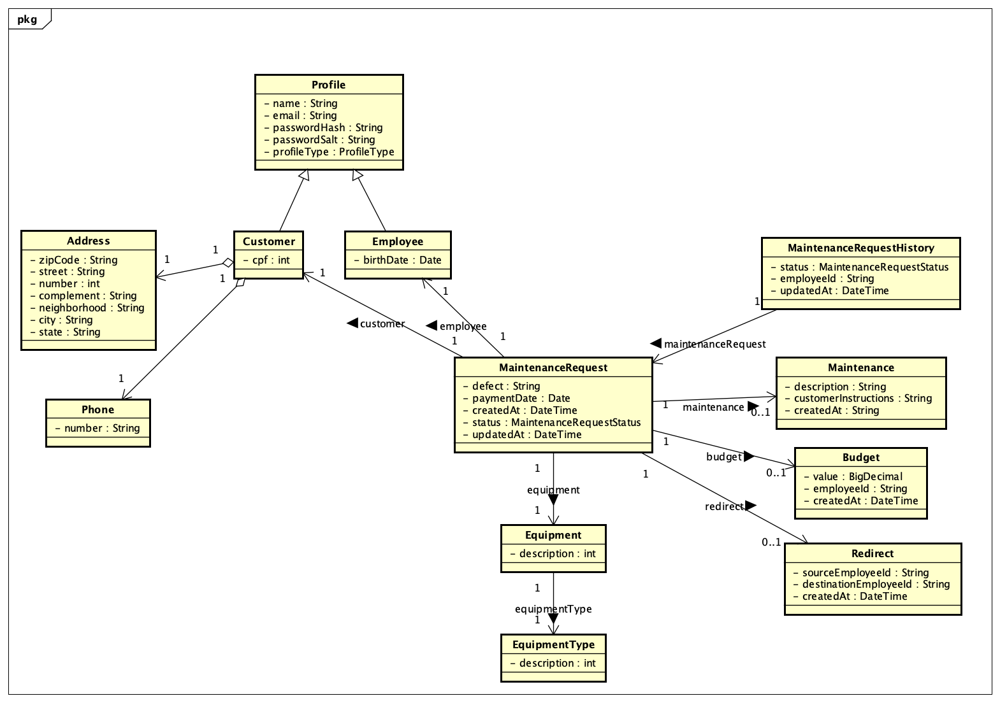

# Controle de Manutenção de Equipamentos

Sistema web para registro e acompanhamento de solicitações de manutenção de equipamentos,
desenvolvido para a disciplina de **Desenvolvimento Web 2** (4º semestre).

O repositório é um monorepo com duas aplicações independentes:

| Módulo | Pasta | Stack |
|--------|-------|-------|
| Backend (API REST) | [`equipment-maintenance-control-backend`](equipment-maintenance-control-backend) | Java 21 · Spring Boot 4.1 · JPA/Hibernate · MySQL |
| Frontend (SPA) | [`equipment-maintenance-control-frontend`](equipment-maintenance-control-frontend) | Angular 22 (standalone) · PrimeNG · Tailwind CSS · Vitest |

## Sumário

- [Sobre o projeto](#sobre-o-projeto)
- [Estrutura do repositório](#estrutura-do-repositório)
- [Como executar](#como-executar)
- [Máquina de estados da solicitação](#máquina-de-estados-da-solicitação)
- [API REST](#api-rest)
- [Status dos requisitos](#status-dos-requisitos)
- [Qualidade e CI](#qualidade-e-ci)
- [Pacote de entrega](#pacote-de-entrega)
- [Decisões e limitações conhecidas](#decisões-e-limitações-conhecidas)
- [Documentação complementar](#documentação-complementar)
- [Equipe](#equipe)

## Sobre o projeto

Dois perfis de usuário utilizam o sistema:

- **Cliente** — abre solicitações de manutenção, acompanha o orçamento, aprova ou rejeita o
  serviço, resgata um serviço rejeitado e efetua o pagamento.
- **Funcionário** — visualiza as solicitações em aberto, efetua orçamentos, executa a manutenção,
  redireciona o atendimento para outro funcionário, finaliza a solicitação e emite relatórios.

Cada solicitação percorre uma máquina de estados (de `ABERTA` a `FINALIZADA`) e toda mudança de
estado gera uma linha em `maintenance_request_history`, com data/hora e funcionário responsável.

### Diagrama de classes



O arquivo editável (Astah) está em [`docs/class-diagram/class-diagram.asta`](docs/class-diagram/class-diagram.asta).

## Estrutura do repositório

```
equipment-maintenance-control/
├── .github/workflows/ci.yml          # pipeline de CI (backend)
├── build_delivery.sh                 # monta o .zip de entrega no formato do Moodle
├── docs/class-diagram/               # diagrama de classes (PNG + fonte Astah)
├── equipment-maintenance-control-backend/
│   └── src/
│       ├── main/
│       │   ├── java/.../equipmentmaintenancecontrol/
│       │   │   ├── config/           # CORS, interceptor de token e guarda de perfil
│       │   │   ├── controller/       # auth · profile · equipment · maintenance
│       │   │   ├── domain/           # senha (SHA-256 + salt), JWT e envio de e-mail
│       │   │   ├── exception/        # AppException, ErrorCode, GlobalExceptionHandler
│       │   │   ├── mapper/           # entidade → DTO
│       │   │   ├── model/            # entidades JPA + records de request/response
│       │   │   ├── repository/       # Spring Data JPA
│       │   │   └── service/          # regras de negócio
│       │   └── resources/db/         # schema.sql e seed.sql
│       └── test/                     # JUnit 5 + Mockito + H2 (219 testes)
└── equipment-maintenance-control-frontend/
    └── src/app/
        ├── core/                     # auth, guards, interceptors, layout, notificações
        ├── features/                 # auth · maintenance-requests · employees
        │                             # equipment-categories · reports
        └── shared/                   # models e serviços compartilhados
```

Cada *feature* do frontend segue o mesmo padrão: `api/` (classe abstrata + implementação HTTP +
implementação mock usada nos testes), `models/`, `pages/` e `services/`.

## Como executar

### Pré-requisitos

| Ferramenta | Versão |
|------------|--------|
| JDK | 21 |
| MySQL | 8+ |
| Node.js | 20+ (npm 11) |

O Maven não precisa ser instalado: use o wrapper (`./mvnw`).

### 1. Banco de dados

A aplicação sobe com `spring.jpa.hibernate.ddl-auto=none`, ou seja, **o schema não é criado pelo
Hibernate**. Para uma instalação nova, rode os dois scripts a partir da pasta do backend, nesta
ordem:

```shell
cd equipment-maintenance-control-backend
mysql -u root -p < src/main/resources/db/schema.sql   # cria o banco (DROP + CREATE)
mysql -u root -p < src/main/resources/db/seed.sql     # massa de testes completa
```

> ⚠️ `schema.sql` **apaga** o banco `equipment_maintenance_control` existente.

O `seed.sql` cria a massa mínima exigida pelo enunciado e um pouco mais: 2 funcionários,
4 clientes, 5 categorias e 26 solicitações distribuídas pelos 8 estados, com datas distintas,
orçamentos, manutenções, redirecionamentos e histórico completo.

### 2. Configuração

As credenciais e os segredos são lidos de variáveis de ambiente (veja
`src/main/resources/application.properties`):

```shell
export DB_PASSWORD=sua_senha_do_mysql
export RESEND_API_KEY=sua_chave_do_resend   # envio da senha no autocadastro (RF001)
export JWT_SECRET=...                       # opcional; há um padrão para desenvolvimento
```

> Nunca substitua esses placeholders por valores literais no `application.properties`: o arquivo é
> versionado.

### 3. Backend

```shell
cd equipment-maintenance-control-backend
./mvnw spring-boot:run
```

A API sobe em `http://localhost:8080`. O CORS libera `http://localhost:4200` para
`GET, POST, PUT, DELETE, PATCH, OPTIONS` (`config/WebConfig`).

### 4. Frontend

```shell
cd equipment-maintenance-control-frontend
npm install
npm start
```

A SPA sobe em `http://localhost:4200`.

### Usuários de teste

Criados pelo `seed.sql` — a senha de **todos** é `1234`:

| Perfil | E-mail |
|--------|--------|
| Funcionário | `maria@empresa.com` |
| Funcionário | `mario@empresa.com` |
| Cliente | `joao@email.com` |
| Cliente | `jose@email.com` |
| Cliente | `joana@email.com` |
| Cliente | `joaquina@email.com` |

## Máquina de estados da solicitação

As transições válidas ficam centralizadas em `MaintenanceRequestStatus.ALLOWED_TRANSITIONS` e toda
mudança passa por `MaintenanceRequest.transitionTo(...)`, que grava o histórico e lança
`AppException(INVALID_STATUS_TRANSITION)` em transições proibidas.

```
ABERTA ──▶ ORCADA ──┬──▶ APROVADA ──┬──▶ ARRUMADA ──▶ PAGA ──▶ FINALIZADA
                    │               │        ▲
                    │               ▼        │
                    │        REDIRECIONADA ──┘
                    │               ▲ │
                    │               └─┘ (redirecionamentos ilimitados)
                    │
                    └──▶ REJEITADA ──▶ APROVADA   (resgate do serviço)
```

## API REST

Base: `http://localhost:8080`. Erros seguem o formato de `exception/dto/ErrorResponse` e os
códigos ficam no enum `ErrorCode`.

### Autenticação

Só `POST /auth/login` e `POST /auth/signup` são públicos (`config/WebConfig`). Todas as outras
rotas exigem o cabeçalho `Authorization: Bearer <token>`; o `TokenInterceptor` valida o JWT,
expõe `userId` e `profileType` para os controllers e aplica a anotação `@RequiresProfile`
(`403 ACCESS_DENIED` para o perfil errado). Além disso, o `AccessGuard` garante que um cliente só
acessa as próprias solicitações.

| Método | Rota | Corpo | Requisito |
|--------|------|-------|-----------|
| `POST` | `/auth/signup` | `{name, cpf, email, phoneNumber, address: {...}}` — gera senha de 4 dígitos e a envia por e-mail | RF001 |
| `POST` | `/auth/login` | `{email, password}` — devolve `{profileType, userId, name, email, token}` | RF002 |

### Clientes — `/customers`

| Método | Rota | Observações | Requisito |
|--------|------|-------------|-----------|
| `GET` | `/customers/{id}/maintenance-requests` | Ordenado por `createdAt` crescente, com `JOIN FETCH` | RF003 |

### Funcionários — `/employees`

Todo o controller exige perfil `EMPLOYEE`.

| Método | Rota | Corpo / parâmetros | Requisito |
|--------|------|--------------------|-----------|
| `GET` | `/employees` | Somente funcionários ativos | RF018 |
| `GET` | `/employees/{id}` | — | RF018 |
| `POST` | `/employees` | `{name, email, birthDate, password}` | RF018 |
| `PUT` | `/employees/{id}` | `{name, email, birthDate}` | RF018 |
| `DELETE` | `/employees/{id}` | `?currentEmployeeId=` — desativação lógica | RF018 |

A desativação recusa remover a si mesmo (`EMPLOYEE_CANNOT_DEACTIVATE_SELF`) e o último
funcionário ativo (`EMPLOYEE_LAST_ACTIVE`).

### Categorias de equipamento — `/equipment-type`

Escrita restrita ao perfil `EMPLOYEE`.

| Método | Rota | Corpo | Requisito |
|--------|------|-------|-----------|
| `GET` | `/equipment-type` | Somente categorias ativas | RF017 |
| `GET` | `/equipment-type/{id}` | — | RF017 |
| `POST` | `/equipment-type` | `{description}` | RF017 |
| `PUT` | `/equipment-type/{id}` | `{description}` | RF017 |
| `DELETE` | `/equipment-type/{id}` | — desativação lógica | RF017 |

O equipamento em si não tem CRUD próprio: ele nasce junto da solicitação
(`EquipmentService.newEquipment`), porque o enunciado só pede cadastro de **categorias**.

### Solicitações de manutenção — `/maintenance-request`

| Método | Rota | Corpo | Transição | Requisito |
|--------|------|-------|-----------|-----------|
| `POST` | `/maintenance-request` | `{customerId, equipment: {description, typeId}, defectDescription}` | → `ABERTA` | RF004 |
| `GET` | `/maintenance-request` | — | — | RF013 |
| `GET` | `/maintenance-request/open` | — | — | RF011 |
| `GET` | `/maintenance-request/{id}` | — | — | RF005 · RF008 |
| `POST` | `/maintenance-request/{id}/budget` | `{value, employeeId}` | `ABERTA` → `ORCADA` | RF012 |
| `POST` | `/maintenance-request/{id}/approve` | `{customerId}` | `ORCADA` ou `REJEITADA` → `APROVADA` | RF006 · RF009 |
| `POST` | `/maintenance-request/{id}/reject` | `{customerId, reason}` | `ORCADA` → `REJEITADA` | RF007 |
| `POST` | `/maintenance-request/{id}/maintenance` | `{description, customerInstructions, employeeId}` | `APROVADA` ou `REDIRECIONADA` → `ARRUMADA` | RF014 |
| `POST` | `/maintenance-request/{id}/redirect` | `{sourceEmployeeId, destinationEmployeeId}` | `APROVADA` ou `REDIRECIONADA` → `REDIRECIONADA` | RF015 |
| `POST` | `/maintenance-request/{id}/pay` | — | `ARRUMADA` → `PAGA` | RF010 |
| `POST` | `/maintenance-request/{id}/finish` | `{employeeId}` | `PAGA` → `FINALIZADA` | RF016 |

`GET /maintenance-request/{id}` devolve `MaintenanceRequestDetails`: dados da solicitação, cliente,
equipamento, categoria, orçamento, manutenção, pagamento, finalização e histórico completo. Cada
parte vem no mesmo DTO do recurso correspondente — `equipment` é um `EquipmentResponse` (com `type`
aninhado), `customer` um `CustomerResponse` e todo funcionário um `EmployeeResponse` —, em vez de
campos achatados como `equipmentCategoryName` ou `assignedEmployeeName`.

Aprovar (RF006) e resgatar (RF009) são a mesma transição de domínio — `→ APROVADA`, sem nenhum campo
extra —, então ambos usam `POST /{id}/approve`. O estado atual da solicitação diz qual dos dois está
acontecendo, e o motivo da rejeição continua preservado no histórico após o resgate.

Redirecionar para quem já é o responsável atual devolve `409 SELF_REDIRECT_NOT_ALLOWED`;
redirecionamentos sucessivos entre funcionários diferentes são permitidos e cada um grava uma linha
em `redirect` (origem, destino e data/hora) além do histórico da solicitação.

## Status dos requisitos

Todos os requisitos funcionais estão implementados de ponta a ponta — tela → API → banco. O
frontend consome a API real (`app.config.ts` registra as implementações `Http*ApiClient`); os
`Mock*ApiClient` existem apenas para os testes de componente.

| Requisito | Descrição | Onde |
|-----------|-----------|------|
| RF001 | Autocadastro de cliente, com ViaCEP e senha de 4 dígitos por e-mail | `POST /auth/signup` · `sign-up.component` |
| RF002 | Login com identificação automática do perfil | `POST /auth/login` · `login.component` |
| RF003 | Página inicial do cliente, com botão conforme o estado | `GET /customers/{id}/maintenance-requests` · `customer-request-list.component` |
| RF004 | Solicitação de manutenção | `POST /maintenance-request` · `new-request.component` |
| RF005 | Mostrar orçamento | `GET /maintenance-request/{id}` · `budget.component` |
| RF006 | Aprovar serviço | `POST /{id}/approve` · `budget.component` |
| RF007 | Rejeitar serviço, com motivo | `POST /{id}/reject` · `budget.component` |
| RF008 | Visualizar solicitação e histórico completo | `GET /maintenance-request/{id}` · `request-details.component` |
| RF009 | Resgatar serviço rejeitado | `POST /{id}/approve` · `customer-request-list.component` |
| RF010 | Pagar serviço | `POST /{id}/pay` · `customer-request-list.component` |
| RF011 | Página inicial do funcionário (estado `ABERTA`) | `GET /maintenance-request/open` · `employee-home.component` |
| RF012 | Efetuar orçamento | `POST /{id}/budget` · `budget.component` |
| RF013 | Listagem com filtros (hoje / período / todas) e escala de cores | `GET /maintenance-request` · `customer-request-list.component` |
| RF014 | Efetuar manutenção | `POST /{id}/maintenance` · `maintenance.component` |
| RF015 | Redirecionar manutenção | `POST /{id}/redirect` · `redirect.component` |
| RF016 | Finalizar solicitação | `POST /{id}/finish` · `customer-request-list.component` |
| RF017 | CRUD de categoria de equipamento | `/equipment-type` · `equipment-categories/` |
| RF018 | CRUD de funcionários | `/employees` · `employees/` |
| RF019 | Relatório de receitas em PDF, agrupado por dia | `reports.component` · `reports-pdf.service` |
| RF020 | Relatório de receitas em PDF por categoria | `reports.component` · `reports-pdf.service` |

Requisitos não-funcionais atendidos: Angular 22 standalone + Spring Boot + REST, MySQL
normalizado (3FN, exceto cidade/estado do endereço, como o enunciado permite), validação no front
e no back, senha com **SHA-256 + salt**, endereço preenchido pela **API ViaCEP**, remoção por
desativação lógica com confirmação na tela, datas e valores em formato brasileiro, máscaras nos
campos formatados e escala de cores do RF013 (`STATUS_COLORS` / `STATUS_CLASSES`).

## Qualidade e CI

O GitHub Actions executa a Integração Contínua em todo Pull Request direcionado à `main`,
antes do merge.

```
 feature/minha-branch
       ↓
Pull Request → main
       ↓
 GitHub Actions
       ↓
┌───────────────┐
│ ✓ Formatting  │  Spotless (google-java-format)
│ ✓ Build       │  ./mvnw clean verify
│ ✓ Tests       │  JUnit + H2
└───────────────┘
       ↓
   Code Review
       ↓
     Merge
```

A `main` é protegida: o CI precisa passar antes de um Pull Request poder ser integrado, de modo que
alterações com problema de formatação, compilação ou teste não chegam à branch principal.

### Execução local

As mesmas verificações, a partir de `equipment-maintenance-control-backend`:

```shell
./mvnw spotless:check      # verifica a formatação
./mvnw spotless:apply      # corrige a formatação
./mvnw clean verify        # compila, empacota e roda os 219 testes
```

No frontend:

```shell
npm test                   # Vitest — 61 testes
npm run build              # build de produção em dist/
```

## Pacote de entrega

[`build_delivery.sh`](build_delivery.sh) monta o `.zip` no formato exigido pelo Moodle
(`integrantes.txt`, `Documentacao/`, `Fontes/`), já sem `target/`, `node_modules/`, `dist/` e
arquivos de IDE:

```shell
./build_delivery.sh
```

O script espera um `integrantes.txt` na **pasta acima** do repositório e usa esses nomes para
compor o nome do arquivo gerado.

## Decisões e limitações conhecidas

1. **Relatórios calculados no frontend (RF019/RF020).** `ReportsService` lê
   `GET /maintenance-request` e agrega receita por dia e por categoria no cliente; o PDF é gerado
   com jsPDF. Não existe endpoint de relatório no backend.
2. **Filtros do RF013 aplicados no cliente.** A API devolve todas as solicitações e o componente
   aplica hoje/período/todas e a regra de visibilidade de `REDIRECIONADA` (só aparece para o
   funcionário destino).
3. **O filtro de período do RF019 exige as duas datas.** O enunciado permite datas vazias; a tela
   hoje pede data inicial e final (há presets de 1, 3, 6 e 12 meses).
4. **Migrations manuais.** Não há Flyway/Liquibase: `schema.sql` e `seed.sql` são aplicados à mão.
   O `schema.sql` já está completo para uma instalação nova.
5. **CI cobre apenas o backend.** Os 61 testes Vitest do frontend precisam ser rodados localmente
   com `npm test`.
6. **Hash de senha com SHA-256 + salt**, conforme o enunciado da disciplina — não é um KDF
   (bcrypt/Argon2), portanto não deve ser reaproveitado em produção.

## Documentação complementar

| Arquivo | Conteúdo |
|---------|----------|
| [`equipment-maintenance-control-frontend/README.md`](equipment-maintenance-control-frontend/README.md) | Comandos do Angular CLI |

## Equipe

| Integrante |
|------------|
| João Guilherme Pivatto |
| João Victor Dourado |
| Matheus Alves |
| Samuel Natel |
| Saullo Krieck |
